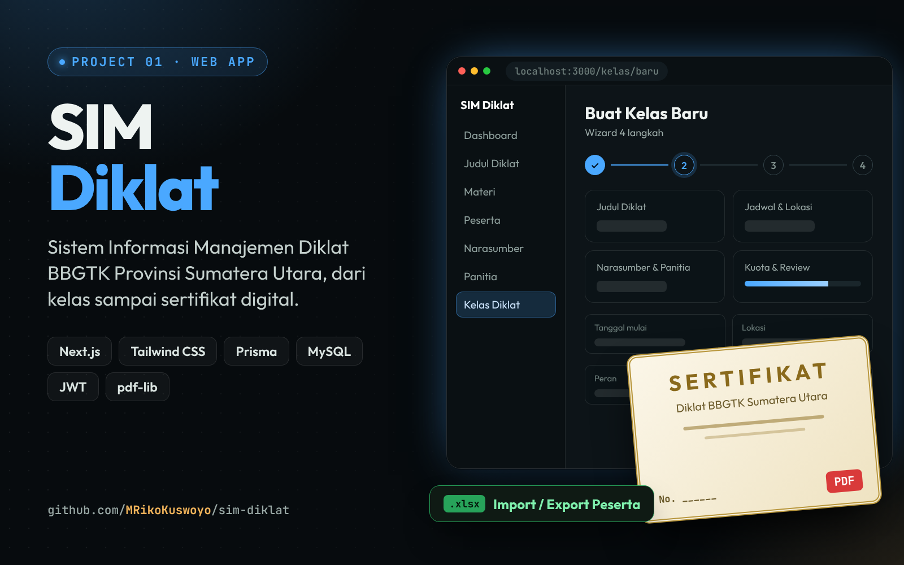
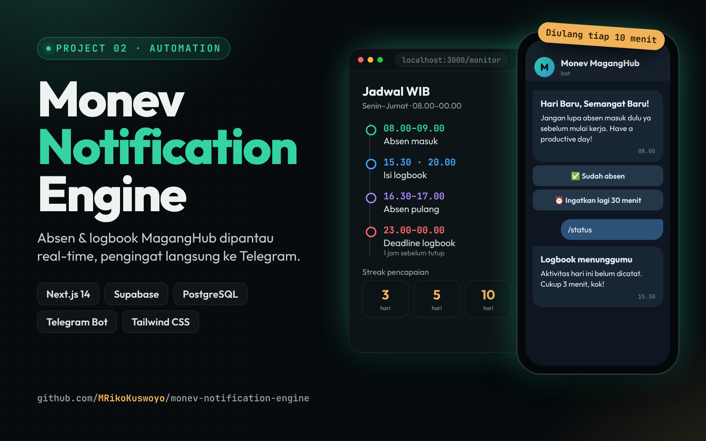
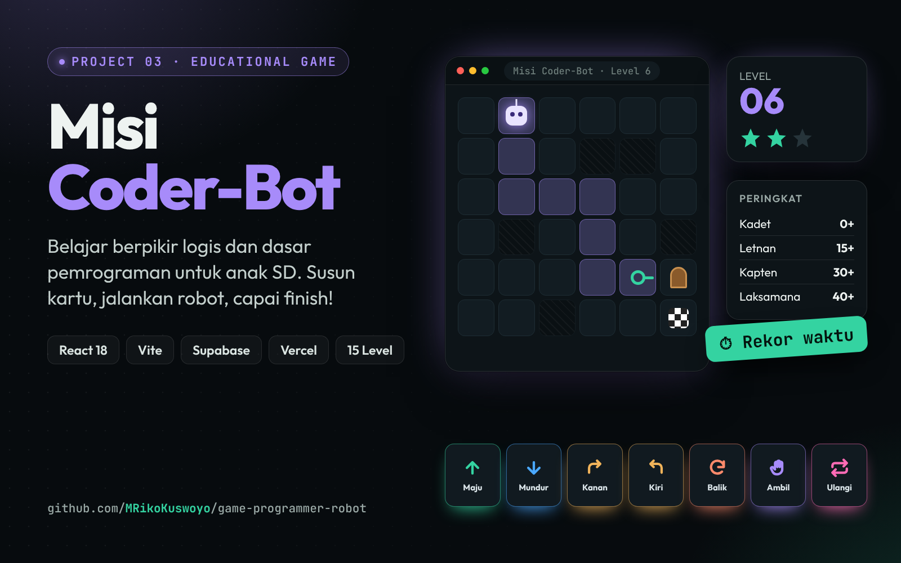
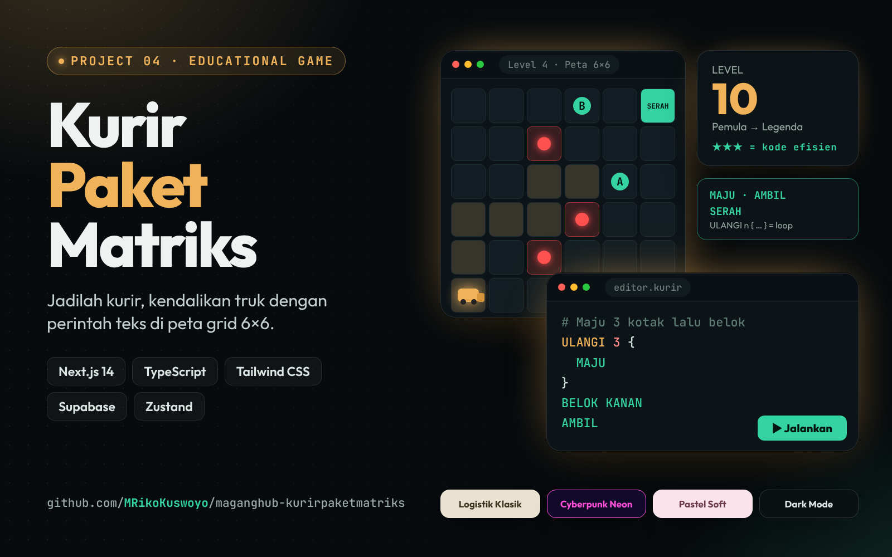
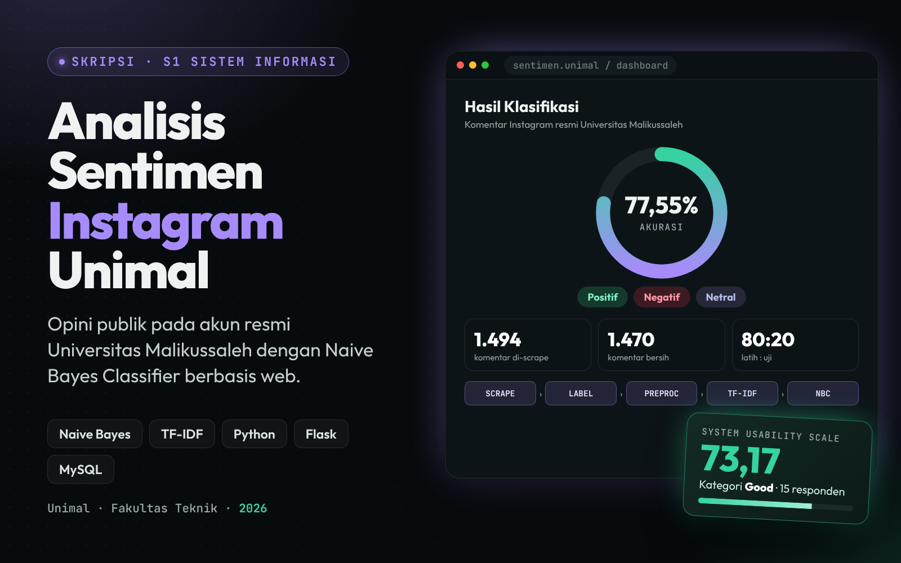
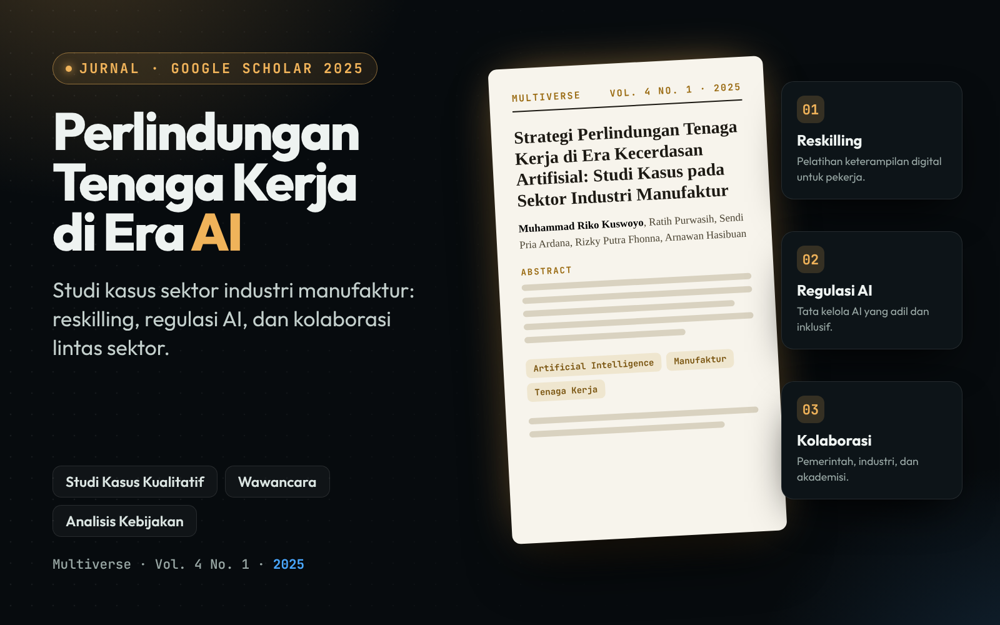
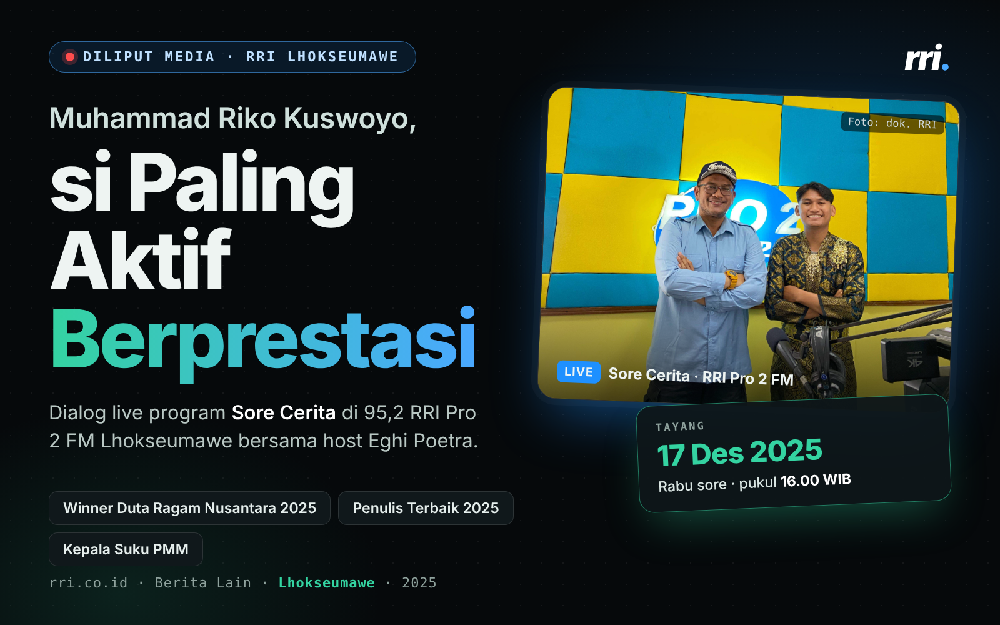
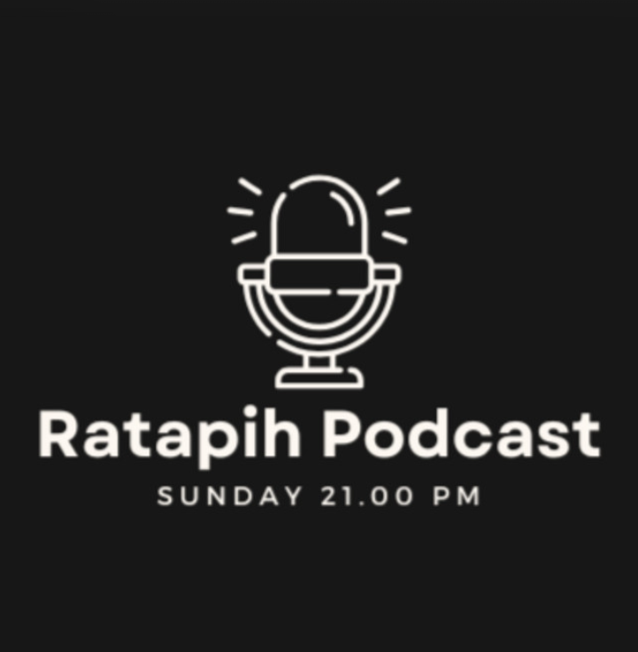

<div align="center">


# Muhammad Riko Kuswoyo

**Fresh Graduate S1 Sistem Informasi · Junior Developer**
*Build · Learn · Ship*

[](https://mrikokuswoyo.vercel.app/)
[](https://github.com/MRikoKuswoyo)
[](https://www.linkedin.com/in/mrikokuswoyo/)
[](https://www.instagram.com/mdrkksy)

</div>

---

## 👋 Tentang Repo Ini

Ini adalah website portofolio pribadi saya. Isinya perkenalan diri, pendidikan, pengalaman, organisasi, pencapaian, sertifikat, proyek yang pernah dibuat, dan kontak.

Saya lulusan S1 Sistem Informasi **Universitas Malikussaleh (IPK 3,82)** yang fokus pada pengembangan sistem dan web: dokumentasi proses, perancangan database (MySQL, PostgreSQL), desain UI/UX, sampai aplikasi dengan HTML, CSS, JavaScript, dan PHP (Laravel). Saat ini saya mencari kesempatan magang di bidang **web development**.

## ✨ Fitur Website

- 🪪 **Kartu ID 3D** interaktif di halaman utama (Three.js), bisa ditarik ke mana saja
- 🌐 **Dua bahasa**: Indonesia dan English
- 🌗 **Tema gelap dan terang**
- 🤖 **Tanya AI**: chat yang menjawab pertanyaan tentang saya dari data portofolio
- 🗂️ **Tab portofolio** berisi proyek, sertifikat, dan pencapaian, lengkap dengan halaman detail
- 🏅 **Sertifikat dua sisi** yang bisa dilihat dan diunduh
- 💬 **Kolom komentar** pengunjung (Supabase)
- 🎵 **Pemutar lagu dengan lirik** di bagian kontak, plus peta lokasi
- 📱 Responsif untuk HP dan desktop

## 🚀 Proyek Unggulan

<table>
  <tr>
    <td width="50%" valign="top">
      <a href="https://github.com/MRikoKuswoyo/sim-diklat">
        
      </a>
      <h3>SIM Diklat</h3>
      <p>Sistem Informasi Manajemen Diklat BBGTK Provinsi Sumatera Utara: kelola diklat, kelas, peserta, narasumber, panitia, import/export Excel, dan sertifikat digital PDF.</p>
      <sub><code>Next.js</code> · <code>Tailwind CSS</code> · <code>Prisma</code> · <code>MySQL</code></sub>
    </td>
    <td width="50%" valign="top">
      <a href="https://github.com/MRikoKuswoyo/monev-notification-engine">
        
      </a>
      <h3>Monev Notification Engine</h3>
      <p>Monitoring absen dan logbook peserta MagangHub dengan dashboard real-time dan pengingat otomatis lewat Telegram.</p>
      <sub><code>Next.js 14</code> · <code>Supabase</code> · <code>PostgreSQL</code> · <code>Telegram Bot</code></sub>
    </td>
  </tr>
  <tr>
    <td width="50%" valign="top">
      <a href="https://github.com/MRikoKuswoyo/game-programmer-robot">
        
      </a>
      <h3>Misi Coder-Bot</h3>
      <p>Game edukasi dasar pemrograman untuk anak SD. Susun kartu perintah, jalankan robot, dan capai finish di 15 level.</p>
      <sub><code>React</code> · <code>Vite</code> · <code>Supabase</code> · <code>PHP</code> · <code>MySQL</code></sub>
    </td>
    <td width="50%" valign="top">
      <a href="https://github.com/MRikoKuswoyo/maganghub-kurirpaketmatriks">
        
      </a>
      <h3>Kurir Paket Matriks</h3>
      <p>Game logika dan dasar pemrograman: kendalikan truk kurir dengan perintah teks di peta grid 6×6, 10 level, dan penilaian bintang.</p>
      <sub><code>Next.js 14</code> · <code>TypeScript</code> · <code>Tailwind CSS</code> · <code>Supabase</code></sub>
    </td>
  </tr>
</table>

## 📰 Publikasi dan Media

<table>
  <tr>
    <td width="50%" valign="top">
      
      <p><b>Skripsi: Analisis Sentimen Unimal</b></p>
    </td>
    <td width="50%" valign="top">
      
      <p><b>Jurnal pertama di Google Scholar</b>: perlindungan tenaga kerja di era kecerdasan artifisial</p>
    </td>
  </tr>
  <tr>
    <td width="50%" valign="top">
      
      <p><b>Narasumber Talkshow Sore Ceria</b> · RRI Pro 2 FM Lhokseumawe</p>
    </td>
    <td width="50%" valign="top">
      
      <p><b>Ratapih Podcast</b>: pendiri dan host, tayang di Spotify</p>
    </td>
  </tr>
</table>

## 🛠️ Teknologi

| Bagian | Yang dipakai |
| --- | --- |
| Tampilan | HTML5, CSS3 (tanpa framework) |
| Logika | JavaScript (vanilla) |
| Efek 3D | [Three.js](https://threejs.org/) via CDN |
| Komentar | [Supabase](https://supabase.com/) (opsional, fallback ke localStorage) |
| Tanya AI | Dari data portofolio di browser, atau Cloudflare Worker (opsional) |
| Hosting | GitHub Pages |

## 📁 Struktur Folder

```
portofolio-koko/
├── index.html        Halaman utama (Home, About, Portfolio, Contact)
├── project.html      Halaman detail proyek
├── tentang.html      Halaman detail pendidikan, pengalaman, organisasi
├── PETA-FILE.md      Panduan "mau ubah X, buka file Y"
├── css/              Gaya tampilan
├── js/
│   ├── data/         Isi konten (data.js, data-en.js, komentar.js)
│   ├── inti/         Logika utama
│   ├── fitur/        Toolbar, chat AI, pemutar lagu
│   ├── visual/       Efek, latar, kartu 3D
│   ├── halaman/      Logika halaman detail
│   └── lib/          Library pihak ketiga
├── assets/           Foto, logo, flyer, sertifikat, lagu, lirik, CV
└── backend/          Contoh backend opsional (Cloudflare Worker, SQL Supabase)
```

Semua teks, proyek, sertifikat, dan kontak diatur di satu tempat: **`js/data/data.js`**. Panduan lengkapnya ada di [PETA-FILE.md](PETA-FILE.md).

## ▶️ Menjalankan Secara Lokal

1. Clone repo ini:
   ```bash
   git clone https://github.com/MRikoKuswoyo/portofolio-koko.git
   cd portofolio-koko
   ```
2. Buka folder di **VS Code**, klik kanan `index.html`, lalu pilih **Open with Live Server**.
   (Atau jalankan `python -m http.server 5500` lalu buka `http://127.0.0.1:5500`.)

Tidak perlu install dependensi apa pun.

## ⚙️ Konfigurasi Opsional

- **Komentar permanen**: buat project di Supabase, jalankan `backend/supabase-komentar.sql`, lalu isi `supabaseUrl` dan `supabaseKey` (publishable key) di `js/data/data.js`.
- **Tanya AI dengan model sungguhan**: ikuti langkah di `backend/ai-worker.js`, lalu isi `ai.endpoint` di `data.js`. Jangan pernah menaruh API key di file website.

## 📬 Kontak

- 📧 muhammadrikokuswoyo5104@gmail.com
- 💼 [LinkedIn](https://www.linkedin.com/in/mrikokuswoyo/)
- 🐙 [GitHub](https://github.com/MRikoKuswoyo)
- 📸 [Instagram @mdrkksy](https://www.instagram.com/mdrkksy)

---

<div align="center">

Dibuat dengan ☕ oleh **Muhammad Riko Kuswoyo**

</div>
